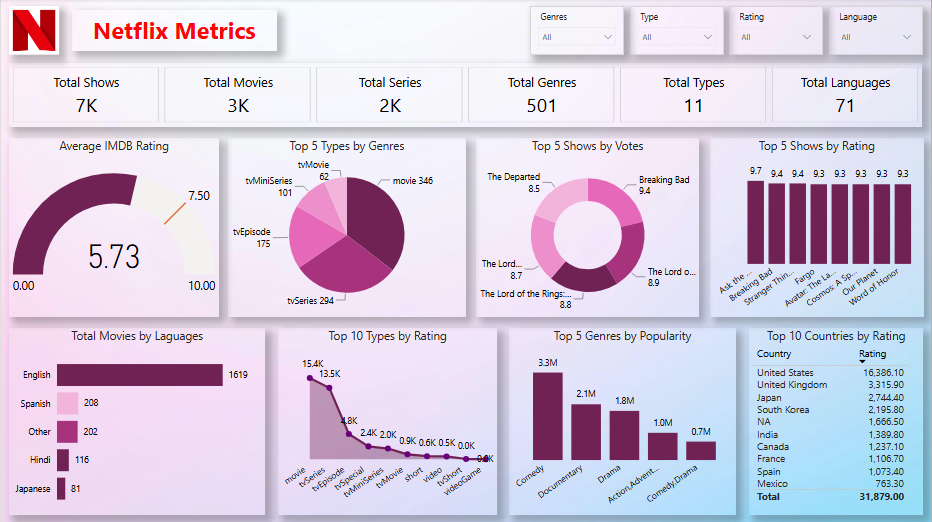

# Netflix

### Power BI Project
This project analyzes Netflix movies and TV shows to explore content distribution, audience preferences, and entertainment trends across genres and countries. A comprehensive Power BI dashboard was developed to visualize content ratings, popularity, and language-wise distribution. The dashboard helps users understand Netflix’s content library, identify popular titles, and explore viewing trends across different categories.

### Tools Covered : Advanced Excel, Power BI, DAX, Power Query

### Key Performance Indicators (KPIs):

• Total Shows

• Total Movies

• Total Series

• Total Genres

• Total Types

• Total Languages

• Average IMDb Rating

• Top 5 Types by Genre

• Top 5 Shows by Votes

• Top 5 Shows by Rating

• Total Movies by Languages

• Top 10 Types by Rating

• Top 5 Genres by Popularity

• Top 10 Countries by Rating

### Dashboard Visualizations:

• Cards

• Gauge

• Pie Chart

• Donut Chart

• Stacked Column Chart

• Stacked Bar Chart

• Line Chart

• Clustered Column Chart

• Table

### Interactive Features:

• Slicers

### Dashboard Preview:

